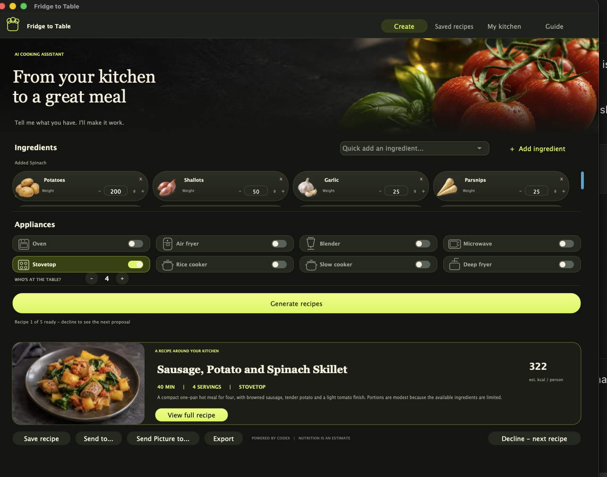
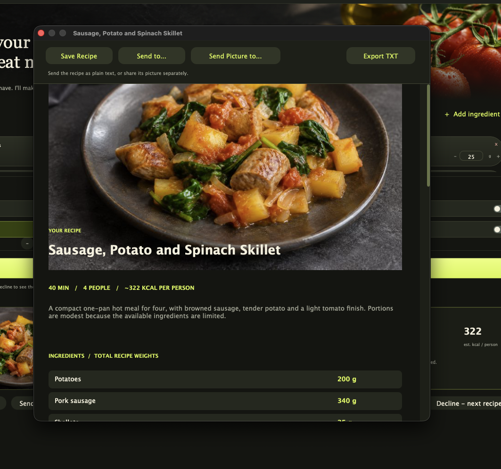
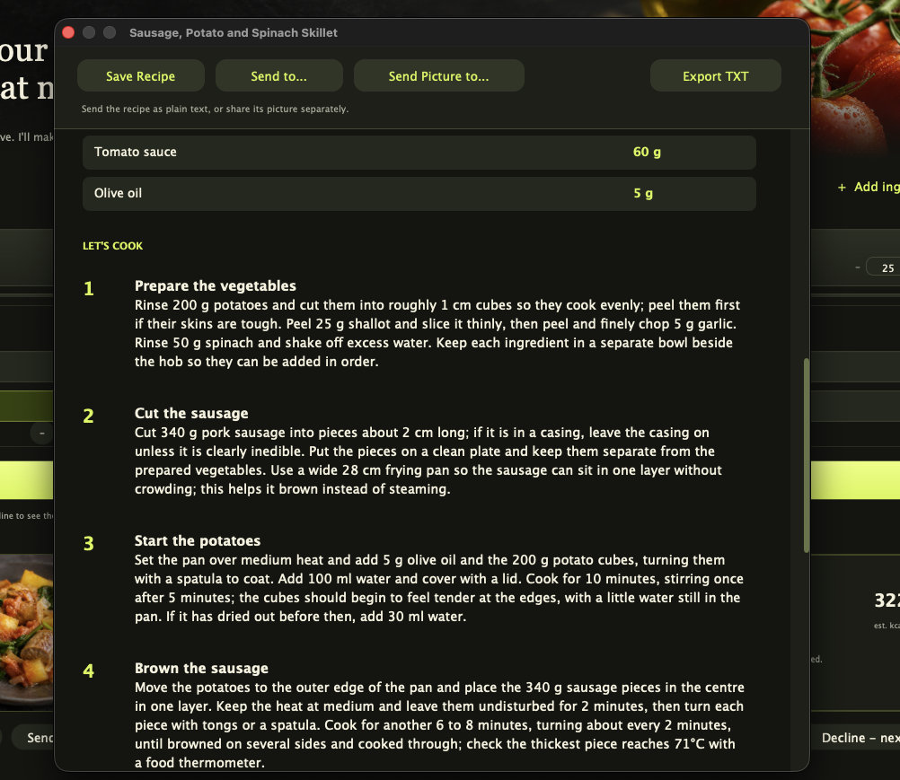

# Fridge to Table

Fridge to Table is a Mac app for deciding what to cook with the ingredients already in your kitchen. Add what you have, enter the quantities, select your appliances, and choose how many people you’re feeding. The app uses your local Codex installation to suggest five meals around those constraints.

[Download the macOS DMG](https://github.com/swihpi/FridgeToTable/releases/latest)



## Install and set up

1. Download the DMG for Apple silicon, open it, and drag **FridgeToTable** to **Applications**. The preview requires macOS 26 or later and is ad hoc signed. It has no Apple notarization ticket.
2. Install Codex and sign in on your Mac. The app uses your local Codex account and requires internet access for generation.
3. Open **FridgeToTable** and select **Test and save** on the setup screen. Leave the path blank to detect Codex automatically, or enter the full path to your Codex executable. Reopen **Codex Setup** from the toolbar whenever you need to change it.

## From ingredients to dinner

- Enter ingredients and weights, choose available appliances, and set the serving count.
- Generate a set of proposals and use **Decline – next recipe** to see another. The selected proposal can have a generated dish photo.
- Open the full recipe for ingredient weights, estimated calories per person, and step-by-step directions. Save a favourite, export it as TXT, or share the recipe text and dish picture separately through macOS.

| Full recipe | Cooking instructions |
| --- | --- |
|  |  |

## Build from source

Install CMake 3.24+ and the Xcode command line tools. The release uses the following JUCE revision.

```sh
git clone https://github.com/juce-framework/JUCE.git external/JUCE
git -C external/JUCE checkout 72782788ce18c2d4d760b28e0921d6ffc6431102
cmake -S . -B build -DCMAKE_BUILD_TYPE=Release -DCMAKE_OSX_DEPLOYMENT_TARGET=26.0 -DJUCE_DIR="$PWD/external/JUCE"
cmake --build build --target FridgeToTable -j4
open build/FridgeToTable_artefacts/Release/FridgeToTable.app
```

Distributed under [AGPL-3.0](LICENSE). The pinned [JUCE source](https://github.com/juce-framework/JUCE/tree/72782788ce18c2d4d760b28e0921d6ffc6431102) is available under its AGPL option.
